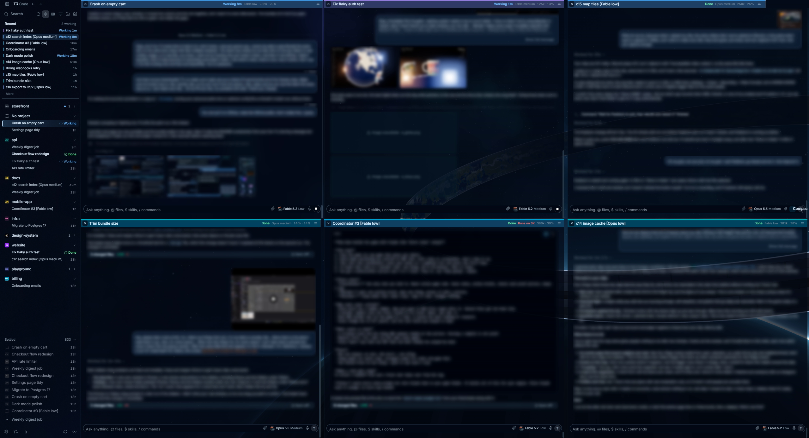
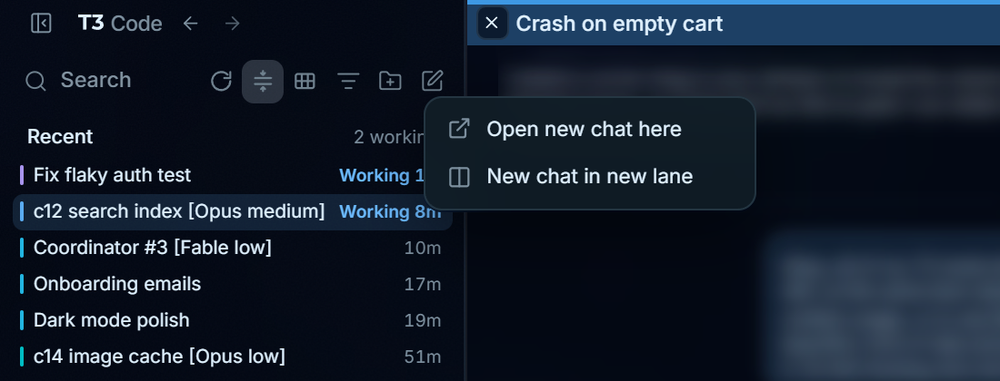
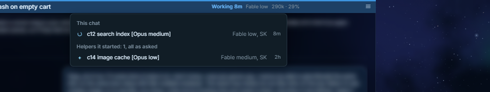
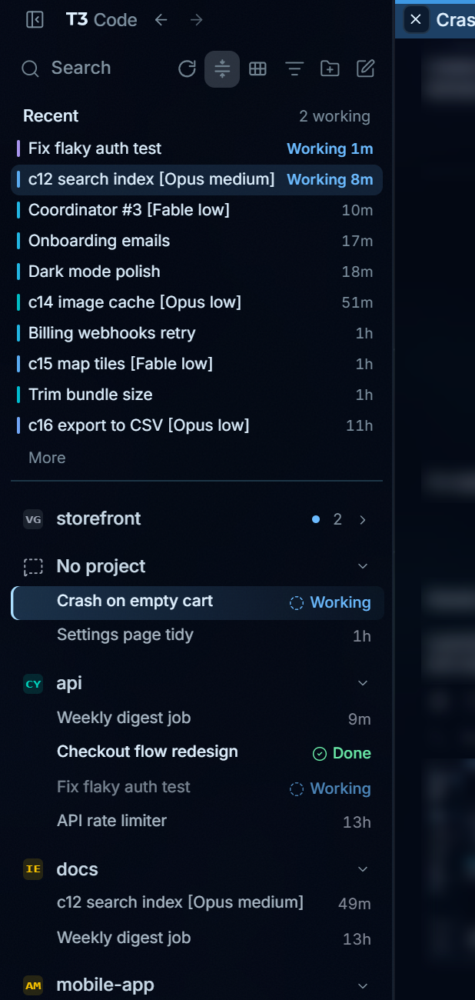
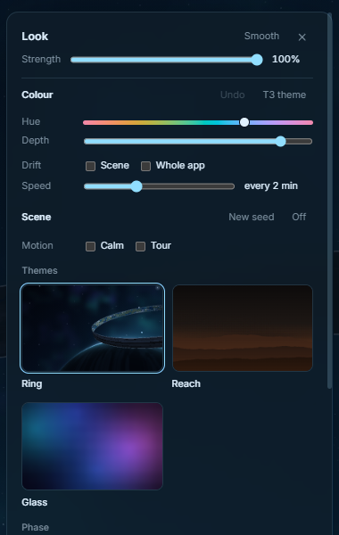

# T3 mods

<p align="center">⭐ if you like this, please star it, it really helps people find it ⭐</p>

Add-ons for [T3 Code](https://t3.codes) on Windows: several chats side by side, a status bar on every chat, a tighter sidebar, right-click menus, animated themes, and Claude chats that copy themselves in.

T3 Code stays the regular app from the official installer. Nothing in its folder is edited, it keeps updating itself, and one script removes everything here.



*Chat text is blurred and the names are made up. The layout is real.*

## What you get

### Lanes: many chats in one window

Open up to eight chats side by side. Two or three sit in a row; four or more make two rows.

- Right-click the new-chat pencil, or a project's **+**, and pick **New chat in new lane**.
- Drag a chat out of the sidebar into the chat area to open it as a lane.
- Drag any line between panes to resize. Drag a point where two lines cross to resize both ways at once. Double-click a line to even it out.
- The grid button beside search picks the layout: **Auto**, **Side by side** or **Two rows**. Closing a pane puts the rest back on an even grid.
- Every pane has an **×**. `Ctrl+Shift+W` closes the one you are in.



### A status bar on every chat

The top of each pane says what that chat is doing, in the same place every time.


Left to right: the chat's title, **Working** or **Done** with how long, the model and effort it runs on, and how much of its context is used (tokens and percent).

### Who is doing what

Click the model name in a status bar to list that chat and every helper chat it started.



Each row has a mark (ring: working, tick: done, cross: failed, dash: stopped, plus: not started yet), the model it really runs on, and how long ago it last moved. Click a row to open that helper in a lane.

If you put the model in a helper's title, like `c12 search index [Opus medium]`, the list checks it. A chat that runs something other than its title says is shown in red, both here and in its status bar. This is how you catch an expensive model doing a cheap job.

### A sidebar that fits more



- **Recent** at the top: the chats you touched last, across every project, with the ones still working marked.
- **Compact mode** (the button beside search) tightens every row so more chats fit on a 1080p screen.
- Each project keeps its coloured badge, and each chat's status bar carries a band of its project's colour.
- The **refresh** button copies in new Claude chats and tidies finished ones out of Recent.
- **Sharing mode**: right-click a chat or project and choose *Hide while sharing*. `Ctrl+Alt+H` hides and shows them everywhere at once, for screen shares.

<br clear="right">

### Themes and scenes

Open **Look** from the sidebar. A theme sets the moving background, the colours and the panels in one click.


| Ring | Reach | Glass |
| --- | --- | --- |
|  |  |  |
| A ringworld over a dark planet. Sunlight travels round the ring. | Ridges against a burning horizon. Embers rise. | Slow fields of colour behind frosted panels. |

Under the themes are 47 more live scenes (strange attractors, cellular automata, night skies, water), a hue and depth slider for the whole app, and a strength slider. Scenes pause when T3 is not in front, and **Smooth** holds everything still.



### Claude chats copy themselves in

Chats you start in the Claude desktop app or the `claude` command line show up in T3 by themselves, in the right project folder. See [Chat sync](#chat-sync).

## Install

You need Windows 10 or 11, T3 Code, and Node.js 22.13 or newer.

**The short way:** open a chat in T3 Code and paste this:

> Set up the T3 mods from https://github.com/prettierweb/t3-mods on this PC. Follow the Install section of its README. Install Node.js first if it is missing. T3 will restart at the end, which closes this chat; that means it worked.

**By hand:**

1. Install T3 Code from [t3.codes](https://t3.codes), open it once, and add your project folders.
2. Install Node.js if you don't have it: `winget install OpenJS.NodeJS.LTS`
3. Get this folder and run the installer in PowerShell:

```powershell
git clone https://github.com/prettierweb/t3-mods
cd t3-mods
powershell -ExecutionPolicy Bypass -File .\install.ps1
```

T3 restarts with the mods. From then on, open T3 the normal way.

If a T3 update ever leaves the mods off, double-click **Start T3 with mods.vbs** in this folder.

### What the installer does

- Adds one login item, `T3 mods.vbs`, to your Startup folder. It runs a small Node script with no window that waits for T3 and attaches the mods.
- Adds two words to T3's shortcuts so it opens with a debugging port that only this PC can reach (`127.0.0.1`).
- Makes `config.json` from the example.

### Uninstall

```powershell
powershell -ExecutionPolicy Bypass -File .\uninstall.ps1
```

This removes the login item, stops the script and puts T3's shortcuts back. Your chats and T3 itself are not touched.

## Updates

Once a day the mods ask this repo whether there is something newer. When there is, a line appears at the foot of the sidebar: **Mods update, ready, click to install**. Click it, then **Update now**. The new version loads into every open window; T3 does not restart.

The mods also check themselves. T3 updates on its own, and an update can move something a mod stands on. When that happens the same line names the mod that needs a fix, for example **Status bar needs a fix**. The other mods keep working, and a fix arrives here as a normal update.

Both checks are free: one small request to GitHub a day, no model. A copy you have edited by hand will not update itself; ask a chat to merge the latest version instead. Set `"checkUpdates": false` in `config.json` to switch the daily check off.

## Chat sync

T3's welcome screen imports your existing Claude chats once. After that the mods keep it current:

- Every 15 minutes while T3 is open, and whenever you press the sidebar's refresh button, new Claude chats are imported.
- A chat lands in the T3 project whose folder it was started in. **Add the folder as a project in T3 first**, or its chats are skipped.
- It uses T3's own import, the same one the welcome screen runs. No model is called, so it costs nothing.
- The first sync scans everything and can take a couple of minutes. Later ones only look at chats made since.

Turn it off or change the interval in `config.json` (`syncChats`, `syncEveryMinutes`).

## Use it from your phone

This part is T3's own feature, not a mod. It lets you read chats, send messages and approve steps from anywhere, while the work runs on your PC.

1. On the PC: **Settings → Sharing & access**, sign in, and switch on **T3 Connect**.
2. In the same place, switch on **Require approval for new devices**. A stolen login then can't reach your PC without you approving it.
3. On the phone: install T3 Code ([iPhone](https://apps.apple.com/us/app/t3-code-remote-claude-more/id6787819824), [Android](https://play.google.com/store/apps/details?id=com.t3tools.t3code)), sign in with the same account and pick your PC.
4. Approve the phone on the PC when it shows a code. Check that the code matches.

The PC has to stay on with T3 open. The phone shows T3's normal screens: lanes, themes and the status bar are desktop only.

More in T3's guide: [Remote access](https://github.com/pingdotgg/t3code/blob/main/docs/user/remote-access.md).

## How it works

T3 Code is built on Electron, the same base as Chrome. Started with a debugging port, it lets a local program add a script to its windows, the way browser dev tools do.

```
T3 mods.vbs (login item)
  └─ node mods/t3-mods.mjs --watch        waits for T3, keeps its shortcuts carrying the port
       ├─ mods/dist/t3-scenes.js           the page script: sidebar, status bar, menus, themes, scenes
       ├─ mods/main-patch.js               inside T3's main process: opens and places lane windows
       ├─ mods/main-swap.js, main-wco.js   drop a chat on a lane; window buttons that fit compact mode
       └─ tools/                           chat sync and Recent tidy, run on demand
```

- **The page script** only reads what T3 already draws and adds its own elements around it. It keeps its settings in the page's local storage.
- **Lanes** are extra T3 windows without a frame, placed over the main window by `main-patch.js`. Each is a full T3 chat, so everything T3 can do works in a lane.
- **The helpers list** reads T3's own database (`~/.t3/userdata/statev2.sqlite`) read-only. Nothing is written to it.
- **Chat sync and tidy** go through T3's own command line and local connection, with a login that lasts ten minutes and is revoked after.

None of it calls a model or sends anything off your PC. Token cost: zero.

### What is T3's and what is ours

| T3 Code's own | Added by these mods |
| --- | --- |
| The app, chats, projects, models, permissions | Lanes and their resize handles |
| Sidebar and its project folders | Recent list, compact mode, sharing mode |
| The chat header | Status word, model, context numbers, project colour band |
| Sub-chats ("helpers") and their data | The helpers list and the title check |
| Importing Claude chats (welcome screen) | Running that import every 15 minutes |
| Phone apps and T3 Connect | Nothing; it is linked here because you'll want it |
| Its built-in colour themes | The Look panel, scenes, and the Ring, Reach and Glass themes |

## Settings

`config.json` (made by the installer, never uploaded):

| Key | What it does |
| --- | --- |
| `syncChats`, `syncEveryMinutes` | Chat sync on or off, and how often |
| `accounts` | A short label per Claude account, shown in the helpers list. Example: `{ "claudeAgent": "Work", "claudeAccount2": "Home" }` |
| `kaniExe`, `atriumExe` | Paths to a browser and a file manager. When set, links and file paths get **Open in…** and **Show in…** in the right-click menu |
| `libraryServer`, `usageModule`, `helperUrl`, `dictation` | The author's own extras. Leave empty |

## Good to know

- Windows only. Built and used daily on one PC with T3 Code 0.1.9; a second PC is the next test.
- This is not made or supported by the T3 team. A T3 update can move things the mods hook into. If something looks off after an update, run uninstall.ps1 to get plain T3 back, and check this repo for a fix.
- Changing the page script: `npm install`, edit `src/`, then `npm run build`. New windows pick up the new build without a restart.
